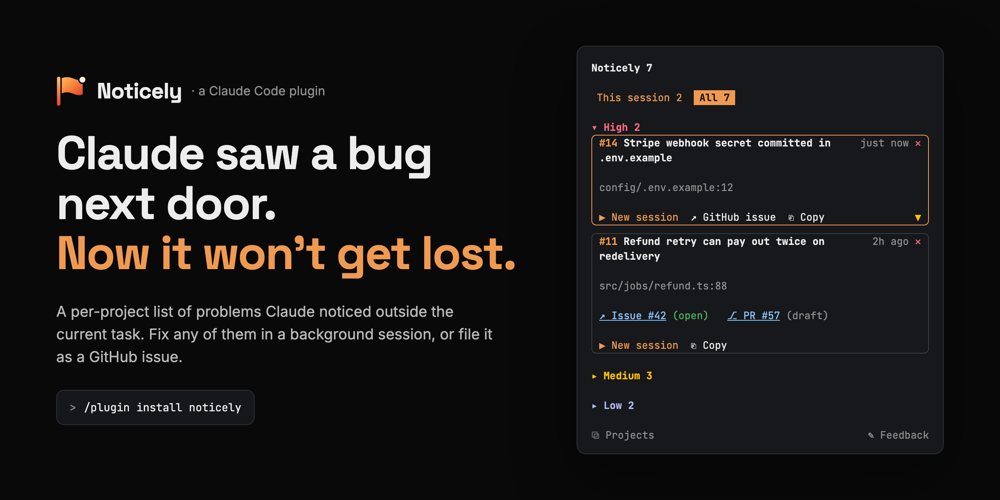
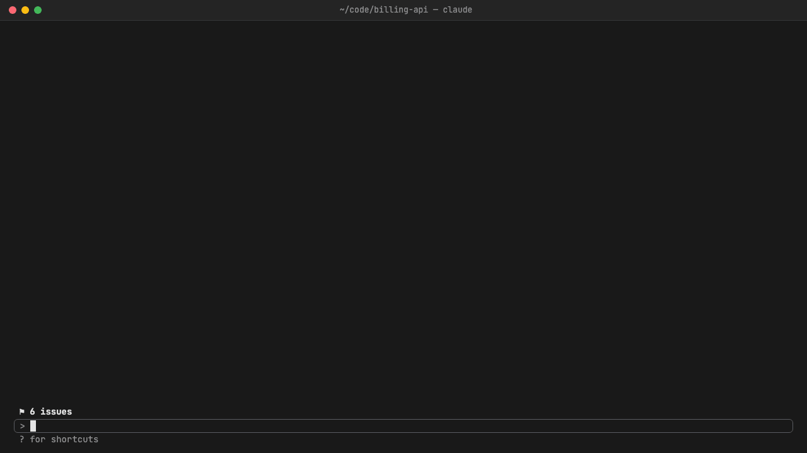

<p align="center"></p>

# Noticely

Noticely is a Claude Code plugin that keeps a per-project list of problems Claude noticed
**outside the current task** and is not fixing right now: a bug next door, a leaked
secret, broken config, a failing check, stale docs. Instead of getting lost in the
conversation, each finding goes on a list that survives across sessions, grouped by
priority. From any entry you can start a background session to fix it, or file a
GitHub or GitLab issue and follow its status.

<p align="center"></p>

A one-minute video, [demo.mp4](docs/assets/demo.mp4), shows it in the terminal, VS Code and the desktop app.

## Install

At the prompt of a Claude Code terminal session:

```sh
/plugin install noticely --marketplace DOstapovets/noticely
```

From a shell:

```sh
claude plugin install noticely --marketplace DOstapovets/noticely
```

In the desktop app, where `/plugin` does not run: click **+** next to the prompt box,
then **Plugins**, **Add marketplace** with `DOstapovets/noticely`, then **Add plugin**.

Then tell Claude to use it. The first session in each repository offers to work out
a rule for that repository (see [Repository rule](docs/repository-rule.md)). For every
project at once, add a rule like this to `~/.claude/CLAUDE.md`, otherwise the model
tends to mention findings in its reply and move on:

```md
When you notice a problem outside the current task that you are not fixing now,
record it with the `note_issue` tool and mention it in one line in your reply.
Call `resolve_issue` once such an issue is fixed.
```

## Updates

Claude Code does not update a plugin from a marketplace like this one by itself, and
the desktop app has no button for it. So Noticely checks once a session: when a newer
version is out, a toast says so once, and **↑ 0.28.0** in the pane's footer installs
it, in the terminal, VS Code and the desktop app alike. `/reload-plugins` or a new
session loads it. The check is off where `DISABLE_UPDATES`, `DISABLE_AUTOUPDATER` or
`CLAUDE_CODE_DISABLE_NONESSENTIAL_TRAFFIC` is set.

To have Claude Code update it on its own instead, turn auto-update on for the
marketplace: in `/plugin`, **Marketplaces**, `noticely`, or in `~/.claude/settings.json`,
which all three read:

```json
"extraKnownMarketplaces": {
  "noticely": { "source": { "source": "github", "repo": "DOstapovets/noticely" }, "autoUpdate": true }
}
```

## What you get

**Three tools for the model**, the first two always listed in the prompt (not behind ToolSearch):

| Tool | What it does |
| --- | --- |
| `note_issue` | Adds an entry: `title` (required), `detail`, `file` (`path[:line]`, a URL or a resource) and `priority` (`high`, `medium` or `low`; `medium` when left out). A field longer than its limit is cut, and the answer says so: `title` to 200 characters, `file` to 500, `detail` to 4000. An entry with the same title, ignoring case, is not added twice. A note like one on the list (half the title's words or more in common, or the same file at any line) is not added either: the answer names up to three such entries, and Claude calls again with `duplicateOf` (the detail goes to that entry, its file is filled in if it had none, its priority raised if the new one is higher) or with `force` (a new entry all the same). |
| `resolve_issue` | Moves an entry, by its `id`, off the list to the **Completed** tab once it is fixed or no longer relevant. |
| `save_issue_rule` | Saves the [repository rule](docs/repository-rule.md), `rule`, cut to 4000 characters. Behind ToolSearch, as only the setup session calls it. |

Under a `note_issue` or `resolve_issue` row in the transcript, the answer is green when the list changed (noted, added to, resolved) and yellow when it did not.

**A count above the prompt**, `⚑ 3 issues`, that opens the pane when pressed. Once the
current session has noted something it says how many, `⚑ 3 issues · 1 this session`. It is
hidden while the list is empty, and any band another plugin draws there stays below it.

**The "Noticely" pane** opens by itself when the list has something on it, and
with `/noticely`. Entries are grouped under **▾ High**, **▾ Medium** and **▾ Low**, one
card each. From a card you start a background session that fixes it (**▶ New session**),
file it as a GitHub or GitLab issue and follow its status (**↗**), copy it, move it to
another priority or delete it. Tabs show what this session noted and what was resolved
(**✓ Completed**); the footer leads to other projects' lists, **⚙ Settings** and
**✎ Feedback**. See [The pane](docs/pane.md).

**Commands:**

- `/noticely` opens the pane (or prints the list, highest priority first, when no pane
  can be placed right now) and refreshes GitHub statuses.
- `/noticely clear` empties the project's list.
- `/noticely setup` starts the analysis that writes the [repository rule](docs/repository-rule.md), again whenever you want it redone.
- `/noticely feedback` does what the pane's [**✎ Feedback**](docs/pane.md#feedback) button does.

## Documentation

- [The pane](docs/pane.md): groups, tabs, cards and their controls, the footer, other
  projects, settings, feedback, and how it looks in VS Code and the desktop app
- [Code tab](docs/code-tab.md) (experimental): `TODO`, `FIXME`, `HACK` and `XXX`
  comments in the code, and **✦ Analyze**
- [Repository rule](docs/repository-rule.md): what the first session in a repository
  works out, and where it is kept
- [GitHub and GitLab](docs/github-gitlab.md): issue and pull or merge request statuses,
  rate limits, and the `github` and `gitlab` options
- [Where the list is kept](docs/storage.md): one list per repository, several sessions
  at once, lists from earlier versions

## Development

```sh
claude plugin validate .
claude plugin test .          # hooks/*.test.ts(x)
claude --plugin-dir .         # a session with this checkout loaded
```

How to work on it, for people and agents alike, and how the code is laid out, is in
[AGENTS.md](./AGENTS.md); branch, commit, version and PR conventions in
[docs/git_and_pr_conventions.md](./docs/git_and_pr_conventions.md), performance budgets in
[docs/performance.md](./docs/performance.md).

## Feedback

Found a bug or want something changed? Press **✎ Feedback** in the pane, or
[open an issue](https://github.com/DOstapovets/noticely/issues/new/choose)
with the **Bug report** or **Feature request** form. Questions go to
[Discussions](https://github.com/DOstapovets/noticely/discussions), security
problems to the private report described in [SECURITY.md](./SECURITY.md). Pull requests:
see [CONTRIBUTING.md](./CONTRIBUTING.md).

## License

© 2026 Dmytro Ostapovets. All rights reserved. Free to install and use; copying,
modifying or redistributing it needs written permission. See [LICENSE](./LICENSE).
